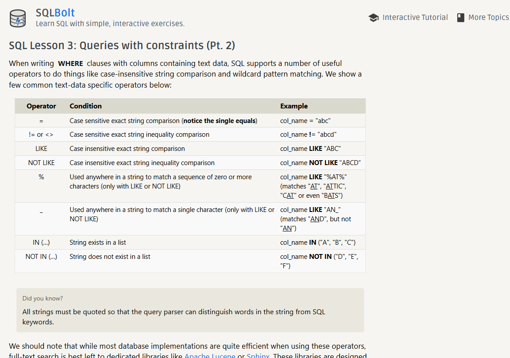

# Labb 1

# MySQL

Skärmdump som visar database explorer i IntelliJ med skapad person-tabell med data:


NOT: Ni ska även ha skapat en user som bara har access till databasen my_database, ingen bild krävs

# MongoDB

Skärmdump av databas på MongoDB Atlas med skapad movie-collection med data:


# SQL

Skärmdump som visar att ni klarat av första två sidorna på sqlbolt.com:s interaktiva tutorial



# Frågor som ni ska svara på (G-nivå)

Besvara frågorna med egna ord. Ge gärna exempel.

## Databaser och verktyg

1. Vad är en databas, och vad kan den användas till?

```
En databas är en kollektion av filer som används för att spara data som går att användas
i flera sessioner och oftast av flera enheter via en DBMS. 
T.ex kan man använda en databas för att spara artiklar i en butik, vad de kostar, när de går ut m.m
```

2. Vad används språket SQL till?

```
Språkt SQL används för att kunna kommunicera samt hantera den datan som finns i en relationsdatabas.
```

## Tabeller och relationer

3. Vad är en tabell, en rad och en kolumn?

```
En tabell håller stycken av data t.ex ID - Namn - Kostnad - Bestföre.
I detta exempel håller Kolumner - ID - Namn - Kostnad - Bestföre.
Rader håller en "produkt" som innehåller dessa värden. De bör ha unika ID'n
```

4. Vad är en primärnyckel, och varför behövs den?

```
En primärnyckel används inom en tabel som en indentiferare för varje rad.
"Varje produkt i föregående frågas exempel är ID't en primärnyckel.
```

5. Vad är en främmande nyckel?

```
En främmande nyckel används för att peka till den informationen i en annan tabel genom att peka till 
primärnyckeln.
```

6. Varför är det bra att lagra kunduppgifter och köp i olika tabeller?

```
Kunduppgifter hörs till användaren medans ett köp strikt är inte kopplat till specifika användare, för att även
korta ner kunduppgifternas tabell så att de inte kräver att byggas upp med massa data är det bättre att skapa en seperate
tabell för köp där man kan istället använda främmande nycklar för att koppla vilken användare som har köpt om det behövs.
```

## NoSQL

7. Vad menas med NoSQL, och hur kan information organiseras i en sådan databas?

```
NoSQL är en databas som inte är relationsbaserad, oftast i form av Dokument, nyckel värde, kolumn eller graf.
```

8. Ge ett exempel på när en NoSQL-databas kan vara lämplig och förklara varför.

```
När man vill skapa en en databas som är ostrukturerad och har mycket varierad data t.ex en chattapplikation. 
```

## SQL – hämta data från tabellen person

Skriv en SQL-fråga som svar på varje uppgift.

9. Hämta alla kolumner för alla personer i tabellen.

```sql
SELECT *
from PEOPLE
```

10. Hämta endast förnamn och efternamn för alla personer.

```sql
SELECT f
from PEOPLE
```

11. Hämta förnamn, efternamn och inkomst för personer med en inkomst över 30 000.

```sql
SELECT people.last_name
from people;
```

12. Hämta alla personer födda före den 1 januari 1990.

```sql
SELECT *
from people
WHERE dob < '1990-01-01'
```

13. Hämta förnamn, efternamn och inkomst, sorterat efter inkomst från högst till lägst.

```sql
SELECT first_name, last_name, income
from people
ORDER BY income DESC
```

14. Räkna hur många personer som finns i tabellen.

```sql
SELECT COUNT(*)
from people
WHERE people.person_id IS NOT NULL
  AND people.first_name IS NOT NULL;
```

# VG-nivå

Dessa frågor ska besvaras med ett längre svar, minst en halv A4-sida:

1. En banköverföring avbryts efter att pengarna dragits från det första kontot. Vad kan konsekvensen bli, och hur kan en
   transaktion hjälpa?

En banköverförning i sig själv är flera saker som ska hända, ett konto ska debiteras medans ett annat konto ska krediteras samt ska båda operationerna i sig själva skickas
till DBMS för att bli querries och autentisera vilket i sig själv ska vara ett bra sätt för DBMS'n att see att till att allt stämmer rätt.

Om banköverförningen avbryts direkt efter pengarna har dragits kan det bli osynkat vilket leder till att den som ska få pengarna kanske får fel mängd då databas servern inte
kan verfiera mot databasen hur mycket ska tas emots, detta blir ett problem på skala då om flera konton osynkas så kanske pengar försvinner eller skapas ur luften beroende på hur
databasen hanterar krediteringen och debiteringen.

Vad en Transaktion gör är att vad som innan var flera operationer blir till en där om alla inte lyckas kommer ingen av de lyckas, detta händer genom att göra alla commits inom
operationen och om något går fel så händer en rollback vilket ändrar tillbaka allt som hände. Om allt lyckades däremot så går det igenom fullt. Vad detta gör för banköverförningen är att
på en operation så skickas pengarna till det andra kontot, kontot tar emot pengarna och transaktionen lyckas och slutförs men om det går fel på en av sidorna debiteringen / krediteringen så händer rollbaken' 
vilket leder till att den delen av transaktions operationen som gick igenom blir omställd och pengarna går tillbaka till kontot eller tas bort från kontot beroende på vilken 
av de som lyckas och misslyckades.


2. Välj ett enkelt system, antingen en webbutik eller en chatt. Resonera om när en relationsdatabas respektive en
   NoSQL-databas kan vara lämplig. Motivera med hur informationen ska lagras och användas.

Inom en webbutik så kan SQL databas vara bra för kontouppgifter och transaktioner / köp medans en NoSQL databas är bra för produkter och annat som inte strikt har en specifik form.

Kontouppgifter och transaktioner har oftast liknande data t.ex - ett konto har namn, email, rabatt m.m - en transaktion har kontot, vad som köptes, hur mycket, totala priset.
För detta är en SQL databas bättre eftersom att det get en strukturerad tabel av varsin typ som har en standard på hur de ska formateras och det är inte mycket extra data som ska läggas till eller ändras.


Produkter och recensioner kan vara olika formaterade samt är de oftast under högre traffik än kontouppgifter och transaktioner t.ex en produkt har inte alltid samma typer av värden, man kan ha klädes artiklar som har
färger, storlek, material medans en matvara har bästföre, ingredienser, vart det kom ifrån m.m. På grund av detta så är en mindre strukturerad standard NoSQL databas bättre för att de är mer flexibla
i olika typer av data och hur tabellerna är uppbygda. Det gäller även för kundvagn då de kan ändras mycket med massor av olika typer av data.

Då producter, recensioner och kundvagnar tar oftast upp mer trafik så kräver de mer horizontel skalbarhet än kontouppgifter.