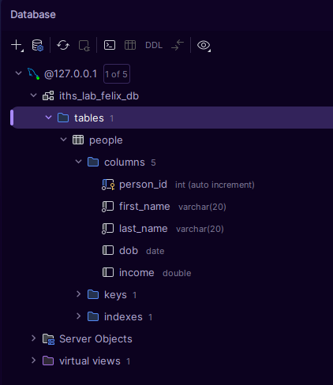
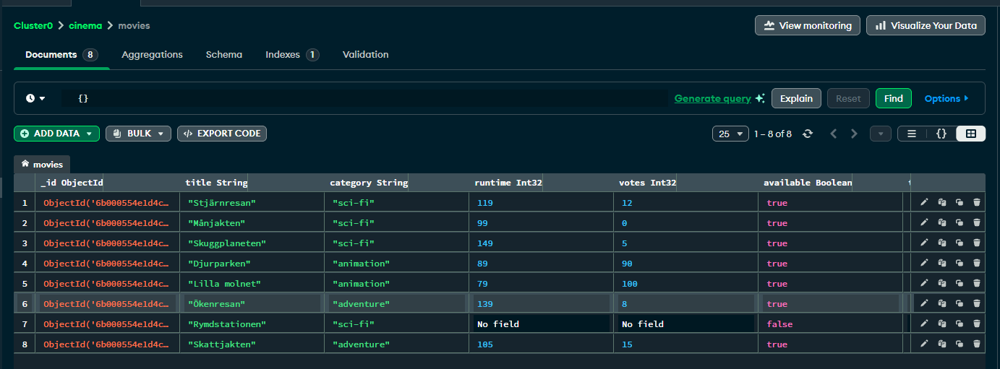

# Labb 1

# MySQL

Skärmdump som visar database explorer i IntelliJ med skapad person-tabell med data:



NOT: Ni ska även ha skapat en user som bara har access till databasen my_database, ingen bild krävs

# MongoDB

Skärmdump av databas på MongoDB Atlas med skapad movie-collection med data:



# SQL

Skärmdump som visar att ni klarat av första två sidorna på sqlbolt.com:s interaktiva tutorial


# Frågor som ni ska svara på (G-nivå)

Besvara frågorna med egna ord. Ge gärna exempel.

## Databaser och verktyg

1. Vad är en databas, och vad kan den användas till?

```
En databas är en kollektion av filer som används för att spara data som går att användas
i flera sessioner och oftast av flera enheter via en DBMS. 
T.ex kan man använda en databas för att spara artiklar i en butik, vad de kostar, när de går ut m.m
```

2. Vad används språket SQL till?

```
Språkt SQL används för att kunna kommunicera samt hantera den datan som finns i en relationsdatabas.
```

## Tabeller och relationer

3. Vad är en tabell, en rad och en kolumn?

```
En tabell håller stycken av data t.ex ID - Namn - Kostnad - Bestföre.
I detta exempel håller Kolumner - ID - Namn - Kostnad - Bestföre.
Rader håller en "produkt" som innehåller dessa värden. De bör ha unika ID'n
```

4. Vad är en primärnyckel, och varför behövs den?

```
En primärnyckel används inom en tabel som en indentiferare för varje rad.
"Varje produkt i föregående frågas exempel är ID't en primärnyckel.
```

5. Vad är en främmande nyckel?

```
En främmande nyckel används för att peka till den informationen i en annan tabel genom att peka till 
primärnyckeln.
```

6. Varför är det bra att lagra kunduppgifter och köp i olika tabeller?

```
Kunduppgifter hörs till användaren
```

## NoSQL

7. Vad menas med NoSQL, och hur kan information organiseras i en sådan databas?

```

```

8. Ge ett exempel på när en NoSQL-databas kan vara lämplig och förklara varför.

```

```

## SQL – hämta data från tabellen person

Skriv en SQL-fråga som svar på varje uppgift.

9. Hämta alla kolumner för alla personer i tabellen.

```sql
SELECT *
from PEOPLE
```

10. Hämta endast förnamn och efternamn för alla personer.

```sql
SELECT f
from PEOPLE
```

11. Hämta förnamn, efternamn och inkomst för personer med en inkomst över 30 000.

```sql
SELECT people.last_name
from people;
```

12. Hämta alla personer födda före den 1 januari 1990.

```sql
SELECT *
from people
WHERE dob < '1990-01-01'
```

13. Hämta förnamn, efternamn och inkomst, sorterat efter inkomst från högst till lägst.

```sql
SELECT first_name, last_name, income
from people
ORDER BY income DESC
```

14. Räkna hur många personer som finns i tabellen.

```sql
SELECT COUNT(*)
from people
WHERE people.person_id IS NOT NULL
  AND people.first_name IS NOT NULL;
```

# VG-nivå

Dessa frågor ska besvaras med ett längre svar, minst en halv A4-sida:

1. En banköverföring avbryts efter att pengarna dragits från det första kontot. Vad kan konsekvensen bli, och hur kan en
   transaktion hjälpa?

```

```

2. Välj ett enkelt system, antingen en webbutik eller en chatt. Resonera om när en relationsdatabas respektive en
   NoSQL-databas kan vara lämplig. Motivera med hur informationen ska lagras och användas.

```

```

